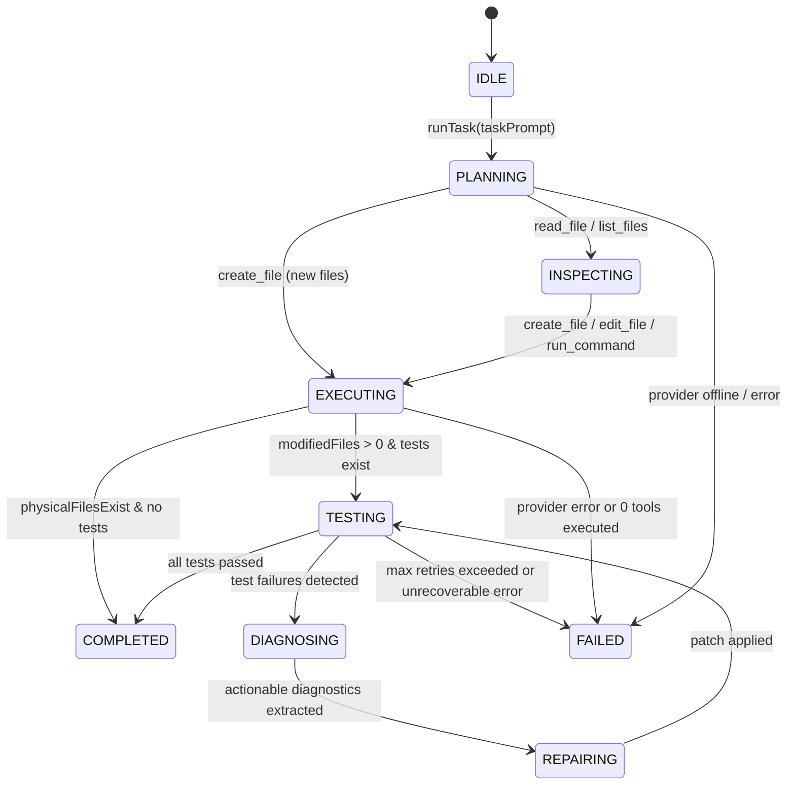

# MAXIDE APEX MISSION 2 — ARCHITECTURAL SPECIFICATION
## Closed-Loop Autonomous Engineering Core & Formalized State Machine

### Core Philosophy

The primary objective of MaxIDE APEX Mission 2 is establishing an **honest, evidence-based autonomous software engineering architecture**. An autonomous IDE cannot claim a feature is complete, an application is built, or a defect is repaired based merely on model assertions or superficial template generation. Completion requires verifiable physical evidence, real tool execution, filesystem inspection, and passed automated tests.

---

### Formalized Agent State Machine

The Agent execution lifecycle is governed by an explicit finite state machine with strict transition guards:



#### Lifecycle State Definitions

1. `IDLE`: The agent engine is idle, waiting for user instructions or workbench events.
2. `PLANNING`: The task prompt is parsed into architectural milestones. Codebase intelligence indexes the project workspace, and model instructions are formulated.
3. `INSPECTING`: The agent reads and inspects existing codebase files (`read_file`, `search_files`, `list_files`). The `InspectionTracker` registers valid inspections with disk timestamps and `mtimeMs`.
4. `EXECUTING`: The agent performs real workspace modifications via registered tools (`create_file`, `edit_file`, `writeFile`, `run_command`). Evidence is recorded in `TaskExecutionEvidence`.
5. `TESTING`: The `ClosedLoopTestEngine` identifies project test suites (`npm test`, `pytest`, `cargo test`, `go test`) and executes them through `SafeTerminal`.
6. `DIAGNOSING`: Test failure traces are parsed into structured, actionable diagnostics (`AssertionError`, `TypeError`, TAP failures, Jest failures).
7. `REPAIRING`: Actionable error diagnostics are fed back into the agent context for targeted patching.
8. `COMPLETED`: Terminal state reached ONLY when physical files exist, commands succeeded, and all automated tests passed.
9. `FAILED`: Terminal state reached when providers fail, max retries are exceeded, or tests persistently fail. Workspace is preserved in its exact state with honest error reporting.

---

### Evidence-Based Proof Before Transition

MaxIDE enforces strict invariants before any task can transition to `COMPLETED`:

```ts
export interface TaskExecutionEvidence {
  inspectedFiles: string[];
  modifiedFiles: string[];
  commandsExecuted: string[];
  testsRun: number;
  testsPassed: number;
  diagnostics: string[];
}
```

#### Guard Rules:
1. **Zero Fake Completions**: If an engineering task (`BUILD`, `CODE_EDIT`, `DEBUG`, `REFACTOR`) produces zero physical file modifications and zero terminal commands:
   - State transitions to: `FAILED`
   - Error code: `NO_TOOLS_EXECUTED: Model did not execute tools to create or modify required files.`
2. **Test Failure Guard**: If automated tests were discovered and executed, but failed (`testsRun > 0 && testsPassed === 0`):
   - State transitions to: `FAILED`
   - Error code: `TESTS_FAILED: Project automated tests did not pass: <diagnostics>`
3. **Provider Outage Guard**: If `generateWithTools` encounters an error event:
   - State transitions immediately to: `FAILED`
   - Error code: `PROVIDER_UNAVAILABLE: <details>`
   - Zero files are written; the workspace is left untouched.

---

### Subsystem Architecture

#### 1. Mandatory Pre-Edit Inspection Guardrail (`InspectionTracker`)
Operates as an independent security layer sitting between the tool executor and the filesystem:
- Maintains a thread-safe inspection cache mapped by session ID and normalized file path.
- Resolves file paths via `WorkspaceManager.resolveSafePathForRoot`.
- Grants immediate authorization for new files (`!fs.existsSync(fullPath)`).
- Blocks edits and overwrites on pre-existing files without prior `read_file`.
- Detects stale inspections if external processes or user edits change file `mtimeMs`.

#### 2. Closed-Loop Test & Auto-Repair Engine (`ClosedLoopTestEngine`)
- Manifest discovery automatically detects Node.js (`package.json`), Python (`pytest.ini`, `pyproject.toml`), Rust (`Cargo.toml`), and Go (`go.mod`).
- Coordinates execution with `SafeTerminal.executeCommand()`, ensuring sandbox rules and timeouts (45 seconds) are honored.
- Diagnostic parser extracts stack traces, assertion messages, and framework error lines into compact arrays suitable for LLM steer prompts.

#### 3. Windows Device Path Guard (`WorkspaceManager`)
- Performs tokenized segment inspection against all 22 legacy DOS reserved device names.
- Strips trailing dots, trailing spaces, and sub-stem spaces before regex evaluation.
- Resolves real canonical paths via `fs.realpathSync` to defeat symlink, junction, and hard link escapes.
