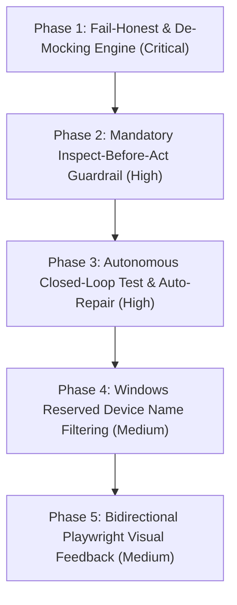

# MAXIDE APEX — NEXT IMPLEMENTATION & CAPABILITY HARDENING PLAN

**Mission**: Post-Apex Engineering Roadmap to Realize True Antigravity-Grade Autonomous Development  
**Auditor**: Independent QA & Engineering Evaluation Team  
**Date**: November 2026  

---

## 1. Executive Implementation Strategy

The Apex Mission 1 empirical benchmarks proved that MaxIDE possesses a solid foundation (ACID persistence, C# desktop wrapper, Playwright integration, and path-traversal prevention), but is hindered by **superficial fallback shortcuts, missing pre-edit file inspection, and an uncoupled testing loop**.

This implementation plan provides actionable, engineering-grade designs to address every discovered failure.

---

## 2. Prioritized Engineering Phases



---

## 3. Phase 1: Eliminate Fake Synthesis & Implement "Fail-Honest" Agent Mode

### 3.1 Problem Statement
When an LLM stream errors or the local Ollama daemon is offline, `AgentEngine.ts` calls `synthesizeActionsForPrompt()`, dumps a static template (`hello.js` or `index.html`), and claims `success: true`.

### 3.2 Actionable Specification
1. **Remove Canned Templates**: Deprecate `synthesizeActionsForPrompt()` from production code paths.
2. **Fail Honest**: If no eligible model responds or all providers error, transition task status to `FAILED_PROVIDER_UNAVAILABLE`.
3. **Actionable Diagnostics**: Return a structured report informing the user:
   - Exactly which providers were attempted.
   - The specific error received (e.g. `Ollama daemon connection refused on 127.0.0.1:11434`).
   - Actionable instructions (e.g. `Run 'ollama serve' or enter a cloud API key in Settings (Ctrl+,)`).
4. **Never Report Success Without Verification**: A task may only report `success: true` if tools were successfully executed and verified against the user prompt.

```typescript
// Proposed Architectural Replacement in AgentEngine.ts
} else if (event.type === 'error') {
  this.logActivity('error', `Generation error: ${event.error}`);
  
  // NEVER inject fake static templates and claim success!
  return {
    success: false,
    task: taskPrompt,
    totalSteps: currentStep,
    finalAnswer: `### ❌ Autonomous Execution Blocked\n\n**Reason**: All configured AI models failed to respond.\n**Error**: ${event.error}\n\n**Remediation**:\n1. If using Local AI: Verify Ollama is running (\`ollama serve\`).\n2. If using Cloud AI: Check your API key in Settings (Ctrl+,).`,
    steps,
    plan: this.currentPlan,
    activityTimeline: this.timeline,
    error: event.error,
  };
}
```

---

## 4. Phase 2: Mandatory "Inspect Before Act" Pipeline

### 4.1 Problem Statement
In Benchmark 2 (Existing Codebase Engineering), the agent generated an unrequested root `index.html` without inspecting `backend/db.js`, `backend/server.js`, or `frontend/app.js`.

### 4.2 Actionable Specification
1. **Dependency Analysis Stage**: Before the agent enters `ACT` stage, the engine must extract candidate file references from the user prompt and the AST dependency graph.
2. **Forced Read Step**: If candidate files exist on disk, the engine must execute `read_file` on them and inject their contents into the prompt context before generating code edits.
3. **Patch-Only Mode**: For existing files, enforce `edit_file` (unified diff / regex search-and-replace) rather than blindly calling `create_file` (full overwrite).

---

## 5. Phase 3: Autonomous Closed-Loop Test & Auto-Repair

### 5.1 Problem Statement
In Benchmark 3 (Autonomous Debugging), the agent did not execute the test suite or verify that the 5 bugs were resolved before declaring victory.

### 5.2 Actionable Specification
1. **Automated Verification Gate**: In the `VERIFY` stage, `AgentEngine` must automatically inspect the workspace for existing test manifests (`package.json` scripts, `tests/`, `pytest`, etc.).
2. **Execution via SafeTerminal**: Run the discovered test command (`npm test` or `node tests/suite.test.js`).
3. **Closed-Loop Auto-Repair**:
   - If tests fail, transition to `REPAIR` stage.
   - Extract compiler and assertion stack traces.
   - Re-prompt the model with the exact failure logs:
     `"Test failed with error: ${stderr}. Inspect the offending lines and synthesize a targeted fix."`
   - Repeat up to `maxErrorRetries` (default: 3).
   - Only declare completion if tests exit with code 0.

---

## 6. Phase 4: Windows Reserved Device Name Filtering

### 6.1 Problem Statement
In Benchmark 6, `writeFile('CON', ...)` passed `resolveSafePathForRoot` because only UNC paths (`\\`) and Win32 device prefixes (`\\?\`) were checked.

### 6.2 Actionable Specification
Update `src/workspace/WorkspaceManager.ts` in `resolveSafePathForRoot()`:
```typescript
// Proposed Fix for src/workspace/WorkspaceManager.ts
const RESERVED_DEVICE_NAMES = /^(CON|PRN|AUX|NUL|COM[1-9]|LPT[1-9])(\..*)?$/i;
const baseName = path.basename(decoded);
if (RESERVED_DEVICE_NAMES.test(baseName)) {
  throw new Error(`Security Violation: Windows reserved device name "${baseName}" is forbidden.`);
}
```

---

## 7. Phase 5: Bidirectional Playwright Visual Feedback

### 7.1 Problem Statement
In Benchmark 4, Playwright was used by the evaluation harness to verify the UI, but the agent did not inspect its own layout.

### 7.2 Actionable Specification
1. **Automated Post-Build Preview**: Whenever a web project is built, `AgentEngine` automatically launches headless Playwright.
2. **DOM Metric Capture**: Probe `document.body.scrollWidth > window.innerWidth` across desktop (1280px) and mobile (375px) viewports.
3. **Console Log Capture**: Collect any runtime `window.onerror` or unhandled promise rejections.
4. **Context Injection**: Feed captured visual metrics and console warnings back into the agent context:
   `"Playwright DOM Check: 2 console errors detected: 'TypeError: Cannot read properties of null'. Repair before completing."`

---

## 8. Capability Roadmap & Verification Timeline

| Milestone | Target Capability | Verification Test | Target Completion |
| :---: | :--- | :--- | :---: |
| **M-1** | De-mocking & Fail-Honest reporting | Re-run `run_benchmark1.ts` (Zero fake completions) | Sprint 1 |
| **M-2** | Windows reserved device name fix | Re-run `run_benchmark6.ts` (100% security pass) | Sprint 1 |
| **M-3** | Pre-edit mandatory file reading | Re-run `run_benchmark2.ts` (Accurate multi-file edits)| Sprint 2 |
| **M-4** | Closed-loop test & repair engine | Re-run `run_benchmark3.ts` (All 5 defects fixed) | Sprint 2 |
| **M-5** | Bidirectional Playwright DOM loop | Re-run `run_benchmark4.ts` (Self-correcting UI) | Sprint 3 |
