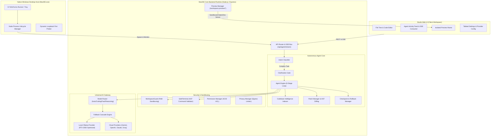
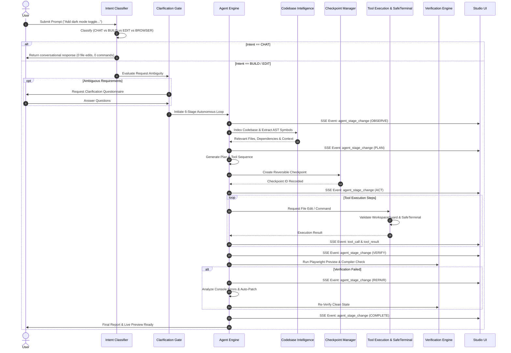
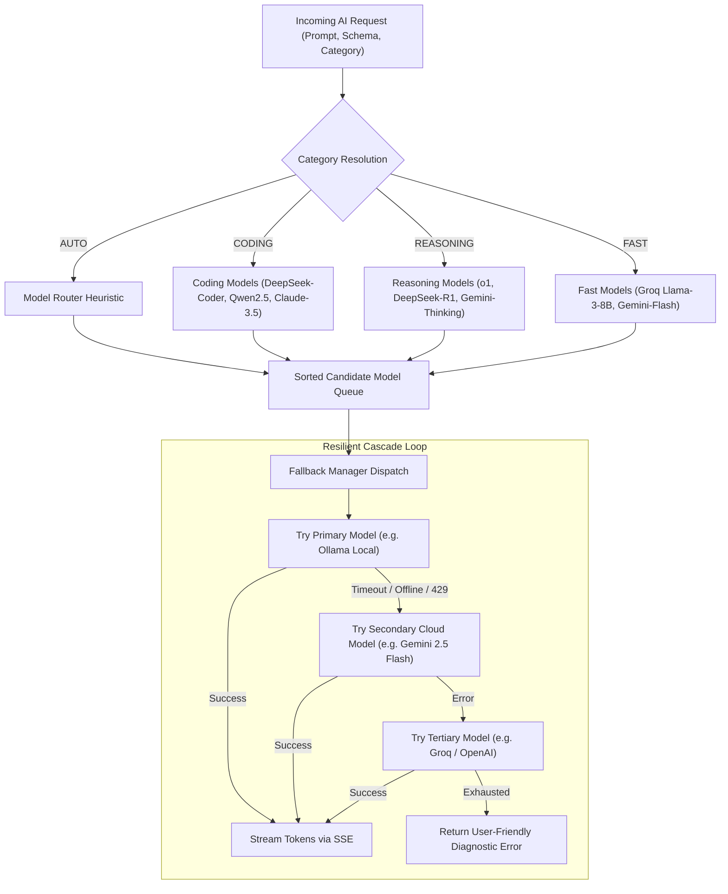

# MAXIDE SYSTEM ARCHITECTURE & DATA FLOW SPECIFICATION

**System**: MaxIDE Autonomous AI Software Engineering Studio  
**Target Architecture**: Windows x64 Desktop Application (.NET C# WinForms Host + Node.js/TypeScript Engine)  
**Revision**: Production Release 1.0  

---

## 1. High-Level Architectural Overview

MaxIDE is structured in three decoupled tiers:
1. **Desktop Host Layer (`desktop/MaxIDE.cs`)**: A native C# Windows application providing the system tray icon, single-instance mutex, automatic Node.js discovery, child process lifecycle management, and window management.
2. **Server & Engine Tier (`src/server/` & `src/agent/`)**: An Express-powered TypeScript runtime hosting the REST API, SSE event streams, AI Gateway, 6-stage autonomous agent execution loop, codebase intelligence indexer, and security sandboxes.
3. **Studio UI Layer (`src/ui/`)**: A responsive single-page IDE workbench providing Monaco-style code editing, split-pane workspace previews, live SSE activity streams, command palettes, and visual checkpoint rollbacks.

---

## 2. Autonomous Agent Execution Lifecycle

When a prompt is delivered to MaxIDE, it transitions through a deterministic 6-stage engineering loop designed to prevent infinite loops, enforce permission boundaries, and guarantee working builds.

---

## 3. Universal AI Gateway & Fallback Architecture

MaxIDE decouples the application from specific AI providers. The `AIGateway` dynamically routes requests based on capability categories (`AUTO`, `CODING`, `REASONING`, `FAST`, `BALANCED`) and executes automatic fallback if any provider encounters rate limits, timeouts, or disconnection.

---

## 4. Secure Filesystem & SafeTerminal Pipeline

Filesystem actions and shell command executions are subjected to multi-layered security gates prior to execution.

```mermaid
flowchart TD
    subgraph FilesystemSecurity["Filesystem Sandboxing"]
        FSAction["File Read / Write / Delete Request"]
        Resolve["WorkspaceGuard: Resolve Absolute Canonical Path"]
        CheckRoot{"Within Workspace Root?"}
        CheckDevice{"Device / UNC Path (CON, AUX, \\\\?\\)?"}
        CheckSecret{"Matches Secret Pattern (.env, id_rsa)?"}
        AllowFS["Execute Filesystem Operation"]
        RejectFS["Reject with 403 Security Exception"]

        FSAction --> Resolve
        Resolve --> CheckRoot
        CheckRoot -->|No| RejectFS
        CheckRoot -->|Yes| CheckDevice
        CheckDevice -->|Yes| RejectFS
        CheckDevice -->|No| CheckSecret
        CheckSecret -->|Yes| RejectFS
        CheckSecret -->|No| AllowFS
    end

    subgraph TerminalSecurity["Terminal Command Sandboxing"]
        CmdInput["Raw Shell Command String"]
        Decompose["AST Decomposition (Split &&, ;, |, `)"]
        AllowlistCheck{"Each Subcommand in Safe Allowlist?"}
        DenylistCheck{"Contains Destructive Flags (rmdir /s, format, dd)?"}
        PermCheck{"Requires Elevated User Approval?"}
        ExecCmd["Execute in Isolated ChildProcess (Timeout Capped)"]
        RejectCmd["Block & Notify User of Security Violation"]

        CmdInput --> Decompose
        Decompose --> AllowlistCheck
        AllowlistCheck -->|No| RejectCmd
        AllowlistCheck -->|Yes| DenylistCheck
        DenylistCheck -->|Yes| RejectCmd
        DenylistCheck -->|No| PermCheck
        PermCheck -->|Approved or Autonomous| ExecCmd
        PermCheck -->|Needs Approval| AskUser["Prompt Approval Modal in Studio UI"]
    end
```

---

## 5. Preview & Dev Server Reverse Proxy

MaxIDE isolates previewed user applications from the IDE studio interface:
1. **MIME Integrity**: All static assets (.html, .css, .js, .wasm, .svg, .json) are served with correct Content-Type headers.
2. **Reverse Proxy**: Dynamic framework servers (Vite on 5173, Next.js on 3000, Express on 8080) are proxied through `/api/preview/proxy` with automatic header rewriting.
3. **Loopback Protection**: Preview endpoints prevent directory escaping and reject external network rebinding.

---

## 6. Atomic Persistence Storage Layer

All stateful data (providers, project list, permissions, checkpoints, conversation logs) is handled by `AtomicStorage`:
1. **Write Staging**: Data is serialized to a `.tmp.[timestamp]` file in the same directory.
2. **Atomic Rename**: `fs.renameSync` atomically swaps the temporary file over the target file, guaranteeing that a crash mid-write never leaves corrupt zero-byte files.
3. **Concurrent Lock**: In-memory file mutex queues concurrent writes.
