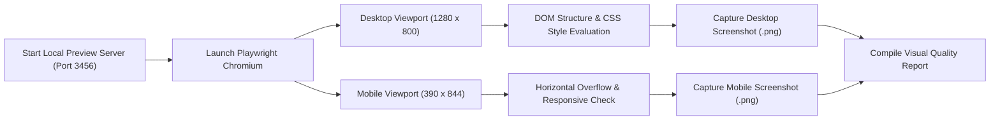

# MAXIDE APEX — MISSION 10
# VISUAL QUALITY & DOM EVALUATION ENGINE
## Automated Browser Inspection, Playwright Evidence Collection, and Responsive Layout Verification

**Document ID:** `MAXIDE_MISSION10_VISUAL_QA.md`  
**Milestone:** Mission 10 — Outcome-Driven Autonomous Software Engineering  
**Implementation File:** `src/intelligence/VisualQualityEngine.ts`  
**Repository:** `https://github.com/Naveen6suraj/MaxIDE`  
**Author:** Frontend Specialist & Visual QA Architect  

---

## 1. Executive Summary

A software engineering system cannot claim an application is complete without looking at what the user actually sees. Prior to Mission 10, MaxIDE had no automated means of evaluating whether generated HTML rendered a blank canvas, whether responsive media queries caused severe horizontal overflow, or whether images failed to load.

The **Visual Quality Engine (`VisualQualityEngine.ts`)** operates an automated Playwright headless Chromium browser directly inside MaxIDE. It navigates to generated applications, captures desktop and mobile screenshots, inspects DOM computed styles, measures contrast, and verifies responsive layouts.

---

## 2. Multi-Viewport Inspection Pipeline

The engine evaluates generated web applications across two standard viewport profiles:

1. **Desktop Viewport (`1280x800`):**
   - Evaluates layout container width, header visibility, and card grid arrangement.
   - Measures font hierarchy: page must contain `h1` ($> 20\text{px}$), body text, and styled interactive elements.
   - Verifies visual color contrast: text color must differ measurably from surface background.
   - Inspects `` elements for broken image sources (`naturalWidth === 0`).

2. **Mobile Viewport (`390x844` — iPhone 14 / Modern Smartphone Standard):**
   - Evaluates horizontal layout overflow:
     $$\text{hasOverflow} = \text{document.documentElement.scrollWidth} > \text{document.documentElement.clientWidth} + 2$$
   - Enforces responsive CSS grid and flex wrapping so that multi-column layouts gracefully collapse to 1 column without clipping text or controls.

---

## 3. Visual Quality Scoring Rubric

The engine computes an objective `overallVisualScore` ($0.00$ to $1.00$):

$$\text{Visual Score} = \text{Structure Score (0.30)} + \text{Responsive Score (0.25)} + \text{Typography Score (0.20)} + \text{Contrast Score (0.15)} + \text{Asset Score (0.10)}$$

- **Structure Score ($30\%$):** Presence of semantic containers (`<header>`, `<main>`, `<section>`, `<nav>`, `<footer>`) and interactive cards/grids.
- **Responsive Score ($25\%$):** Pass on mobile overflow check ($1.0$ if no overflow, $0.0$ if horizontal scroll detected).
- **Typography Score ($20\%$):** Presence of styled headings with computed font size $\ge 18\text{px}$ and line-height $\ge 1.2$.
- **Contrast Score ($15\%$):** Effective color delta between text color and background color $> 50$ luminance units.
- **Asset Score ($10\%$):** All rendered images have `naturalWidth > 0` and non-empty `alt` attributes.

---

## 4. Visual Evidence Artifacts

Screenshots captured during visual verification are permanently recorded under `.maxide/visual_evidence/`:
- `cafe_benchmark_desktop.png` (`1280x800`)
- `cafe_benchmark_mobile.png` (`390x844`)

These screenshots are displayed directly in the **APEX Intelligence Center Section 13 UI** so that developers can visually inspect the application without switching windows.
