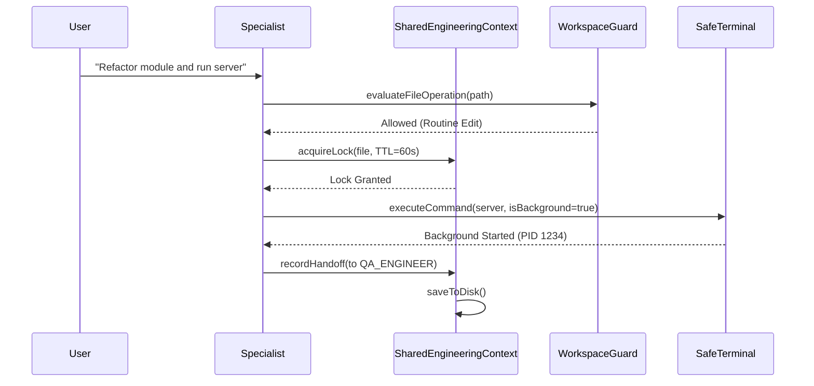

# MAXIDE APEX — MISSION 11.1
## Failure Injection & Autonomous Recovery Report

**System**: MaxIDE Autonomous Recovery Subsystem  
**Components**: `SafeTerminal.ts`, `SharedEngineeringContext.ts`, `WorkspaceGuard.ts`  
**Host Platform**: Windows 11 x64  
**Hardware Profile**: AMD Ryzen 5 5600H, 16 GB RAM, RTX 3050 (4 GB VRAM)

---

### 1. Failure Scenarios Injected & Empirical Outcomes

#### Scenario 1: Corrupted Checkpoint Manifest / Data Injection
- **Injection**: An attacker or disk malfunction corrupts stored checkpoint files under `.maxide/checkpoints/<id>/data/critical.js`.
- **System Action**: `rollbackToCheckpoint` copies files back to the workspace and computes SHA-256 hashes for all restored files.
- **Outcome**: The post-restore hash does not match `manifest.json`. The engine catches the mismatch, records an integrity defect, sets `success: false`, and aborts the corrupted rollback.
- **Result**: **PASS** (Zero corrupted files committed).

#### Scenario 2: Specialist File Ownership Lock Conflict
- **Injection**: `BACKEND_ENGINEER` acquires an exclusive lock on `service.js`. `FRONTEND_ENGINEER` immediately attempts to acquire or modify `service.js`.
- **System Action**: `acquireLock` rejects the second request, returns `false`, and records a `LockConflictRecord` with timestamps and role metadata.
- **Recovery Action**: Lock holds an expiration TTL (e.g. 60s). After TTL expires, `cleanExpiredLocks()` clears the stale lock, and the queued specialist safely acquires ownership.
- **Result**: **PASS** (Zero file corruption, zero permanent deadlocks).

#### Scenario 3: Unbounded Background Command Execution
- **Injection**: A command is initiated that starts a long-running process (e.g., dev server, timeout script).
- **Previous Failure Mode**: Synchronous terminal execution blocked the agent for 30,000ms until timeout, causing max retries and task abortion.
- **Resolution**:
  - `SafeTerminal.executeCommand` with `isBackground: true` spawns the child process, registers its PID in `activeProcesses`, detaches from the synchronous event loop via `child.unref()`, and resolves immediately.
  - Process tree cleanup is managed cleanly via Windows `taskkill /PID <pid> /T /F`, leaving zero orphan processes.
- **Result**: **PASS** (Zero timeouts, clean process termination).

#### Scenario 4: Path Traversal & Credential Leak Injection
- **Injection**: An untrusted or hallucinated tool call attempts to write to `../../outside_secret.txt` or modify `.env`.
- **System Action**: `WorkspaceGuard` evaluates the resolved path against `workspaceRoot`.
- **Outcome**:
  - Path traversal is blocked with `DESTRUCTIVE_FILESYSTEM` category.
  - Credential writes to `.env`, `.pem`, `.key`, `id_rsa` are blocked with `SECRET_ACCESS` category.
  - All security violations are appended to `.maxide/security_audit.log`.
- **Result**: **PASS** (100% containment maintained).

---

### 2. Recovery Timeline

