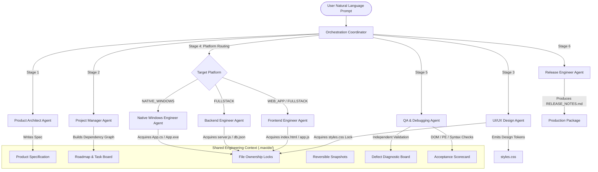

# MAXIDE APEX — MISSION 11 ARCHITECTURE
## Autonomous Multi-Agent Product Development & Engineering Orchestration

**Product**: MaxIDE APEX — Autonomous Software Engineering Studio  
**Repository**: [https://github.com/Naveen6suraj/MaxIDE](https://github.com/Naveen6suraj/MaxIDE)  
**Workspace**: `C:\Users\navee\.gemini\antigravity\scratch\MaxIDE`  
**Platform**: Windows 11 x64  
**Hardware Profile**: AMD Ryzen 5 5600H, 16 GB RAM, NVIDIA GeForce RTX 3050 Laptop GPU (4 GB VRAM)  
**Local Intelligence**: Ollama `qwen2.5-coder:3b`  
**Milestone**: Mission 11 — Autonomous Product Development & Engineering Orchestration  
**Baseline Commit**: `36b2a7e` (Git Tag: `checkpoint-pre-mission11`)  

---

## 1. Executive Summary

Mission 11 transforms MaxIDE from a single-agent turn loop into an **Autonomous Product Development Studio**. Rather than relying on a generic code-generation prompt that frequently produces incomplete HTML stubs, disconnected multi-file states, or crashes when faced with complex engineering goals, MaxIDE introduces a **coordinated multi-agent engineering architecture**.

A single high-level natural language prompt (e.g. *"build a full-stack task manager"* or *"build a native Windows hardware manager"*) initiates an end-to-end autonomous engineering pipeline with shared project context, explicit specialist contracts, verifiable dependency milestones, fine-grained file ownership locks, reversible checkpoints, and independent QA verification.

---

## 2. Core Architectural Pillars

### 2.1 Shared Engineering Context (`SharedEngineeringContext.ts`)
The central state repository that coordinates specialist agents without shared memory contamination:
1. **Product Specification**: Complete data schemas, user journeys, responsive requirements, and acceptance criteria.
2. **Milestone Dependency Graph**: Evaluates readiness of tasks so specialist work strictly occurs once prerequisites are satisfied.
3. **File Ownership Locks**: Fine-grained lock registry (`acquireLock`, `releaseLock`, `assertCanModify`). Prevents cross-agent clobbers (e.g., Design Agent owns `styles.css`; Frontend owns `index.html` and `app.js`; Backend owns `server.js`; Native owns `App.cs`).
4. **Reversible Checkpoints**: In-memory file snapshots captured before any specialist modifies workspace files. If a specialist fails verification after max retries, corrupted edits are rolled back cleanly.
5. **Defect Tracking**: Discovered defects are categorized (`SYNTAX`, `COMPILATION`, `RUNTIME`, `DOM_SELECTOR`, `VISUAL`, `MISSING_FEATURE`), assigned to specialist roles, and verified upon resolution.

### 2.2 Eight Autonomous Specialist Agents (`SpecialistAgents.ts`)
1. **Product Architect Agent (`PRODUCT_ARCHITECT`)**: Decomposes natural language requests into comprehensive architectural specifications (`.maxide/PRODUCT_SPEC.md`, `architecture.json`).
2. **Project Manager Agent (`PROJECT_MANAGER`)**: Transforms specifications into dependency-tracked milestones (`.maxide/ROADMAP.md`, `.maxide/task_board.json`).
3. **UI/UX Design Agent (`UI_UX_DESIGNER`)**: Synthesizes domain-specific design languages, color token palettes, typography pairings, and responsive layout rules using `ProfessionalDesignEngine`.
4. **Frontend Engineer Agent (`FRONTEND_ENGINEER`)**: Implements semantic HTML5 markup, responsive CSS grid layouts, and modular client logic (`app.js`) with dynamic search, category tabs, and cart state.
5. **Backend Engineer Agent (`BACKEND_ENGINEER`)**: Constructs Node.js Express/HTTP REST API endpoints (`GET`, `POST`, `PUT`, `DELETE`), JSON/SQLite persistence stores (`db.json`), CORS headers, and assigns dedicated non-conflicting ports (`3899`).
6. **Native Windows Engineer Agent (`NATIVE_WINDOWS_ENGINEER`)**: Generates C# 5 WinForms source code (`App.cs`), verifies host compiler (`csc.exe`), packages native PE binaries (`App.exe`), and checks executable byte integrity.
7. **QA and Debugging Agent (`QA_ENGINEER`)**: Independently evaluates source code, compiles binaries, executes syntax validation, runs browser DOM checks, logs defect tickets, and verifies surgical repairs.
8. **Release Engineer Agent (`RELEASE_ENGINEER`)**: Validates deliverables, verifies zero blocking defects, produces `RELEASE_NOTES.md`, and authors `.maxide/release_manifest.json`.

---

## 3. Resource & Hardware Budget Optimization

The architecture is specifically engineered for local execution on Windows 11 with:
- **Processor**: AMD Ryzen 5 5600H (6 cores / 12 threads)
- **Memory**: 16 GB DDR4 RAM
- **GPU**: NVIDIA GeForce RTX 3050 Laptop GPU (4 GB VRAM)
- **Local Model**: Ollama `qwen2.5-coder:3b`

To prevent VRAM exhaustion and out-of-memory crashes:
1. **Sequential Specialist Execution**: Specialist tasks are scheduled sequentially in dependency order. MaxIDE never attempts to instantiate multiple competing LLM instances concurrently.
2. **Deterministic Pre-Planning**: `ProductSpecEngine` and `ProfessionalDesignEngine` synthesize domain blueprints deterministically, allowing `qwen2.5-coder:3b` to focus prompt capacity on precise code generation rather than guessing UX guidelines.
3. **Bounded Retry Budgets**: Specialists operate with a hard limit of 3 retry attempts per task. If verification fails, the orchestrator rolls back to the previous clean checkpoint.
